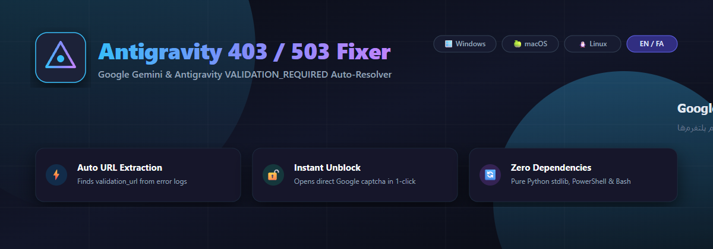
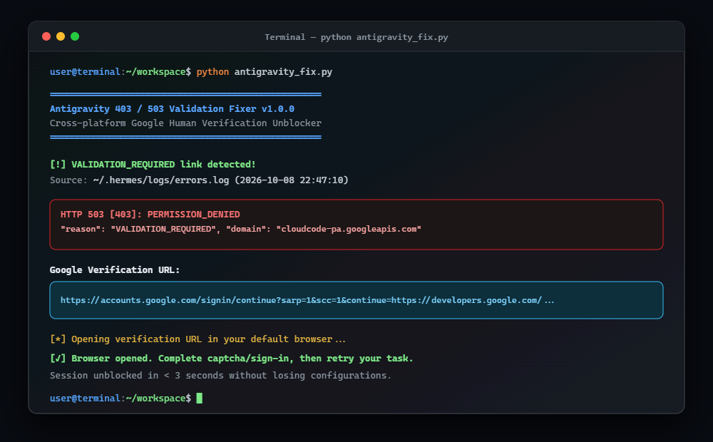

# Antigravity 403 / 503 & License Error Auto-Fixer

[](LICENSE)
[](#quick-start)
[](#cross-platform-python-cli)
[](README_FA.md)

[🇮🇷 **مشاهده مستندات به زبان فارسی (Persian README)**](README_FA.md)

---



> 🚨 **Special Guide / Troubleshooting Post:**  
> **[Fix: Google One 5TB / AI Pro Ineligible Quota (#3501 SUBSCRIPTION_REQUIRED) & Age Verification Bypass](docs/GOOGLE_ONE_AI_PRO_AGE_VERIFICATION.md)**  
> [🇮🇷 راهنمای تخصصی رفع خطای عدم شناسایی اشتراک ۵ ترابایت و احراز سن](docs/GOOGLE_ONE_AI_PRO_AGE_VERIFICATION_FA.md)

An automated utility to resolve **HTTP 503 [403]: `PERMISSION_DENIED (VALIDATION_REQUIRED)`** and **License Error `#3501`** across **Google Antigravity CLI**, **Antigravity IDE**, **Gemini Code Assist**, and **Hermes Agent**.

---

## ⚡ The Problem

When using Google Antigravity or AI agent bridges (9Router, Hermes), you may encounter unexpected stops:

```json
HTTP 503 [403]: PERMISSION_DENIED
{
  "error": {
    "code": 403,
    "message": "Verify your account to continue.",
    "status": "PERMISSION_DENIED",
    "details": [
      {
        "reason": "VALIDATION_REQUIRED",
        "domain": "cloudcode-pa.googleapis.com",
        "metadata": {
          "validation_url": "https://accounts.google.com/signin/continue?..."
        }
      }
    ]
  }
}
```

Or within the IDE:
> `You do not have a valid license of this product. (#3501)`

### Why Does This Happen?
1. **Human Verification Trigger (`VALIDATION_REQUIRED`):** When query volume spikes or quota depletes (following HTTP 429), Google's bot protection flags the account and demands an interactive captcha verification.
2. **Hidden Validation URL:** Google delivers a temporary `validation_url` deep inside response metadata, but standard CLIs suppress or truncate this URL, leaving users stranded.
3. **Session Lockups:** The background `language_server` or stale OAuth tokens in `~/.gemini` or `~/.antigravity` remain locked in the broken state.

---

## 🖥️ Preview



---

## 🚀 Quick Start (All Operating Systems)

### 1. Universal Python CLI (Recommended)

Zero third-party dependencies — runs on standard Python 3:

```bash
# Clone the repository
git clone https://github.com/nic40246-dot/antigravity-403-fix.git
cd antigravity-403-fix

# Run the auto-fixer (scans logs, extracts URL, opens browser)
python antigravity_fix.py
```

#### CLI Options:
```bash
python antigravity_fix.py --help

  --no-open    Print the verification URL without opening the browser automatically
  --reset      Force kill running Antigravity processes and purge stale caches
  --log PATH   Specify a custom log file path to scan
```

---

### 2. Windows (PowerShell)

Run directly in PowerShell:

```powershell
powershell -ExecutionPolicy Bypass -File .\fix-windows.ps1
```

Or run the one-line session cleaner:
```powershell
Stop-Process -Name *antigravity* -Force -EA 0; Remove-Item -Recurse -Force "$HOME\.antigravity","$HOME\.gemini" -EA 0
```

---

### 3. macOS (Terminal)

```bash
chmod +x fix-unix.sh
./fix-unix.sh
```

Or one-line reset:
```bash
pkill -9 -f Antigravity 2>/dev/null; security delete-generic-password -s gemini -a antigravity 2>/dev/null; rm -rf ~/.antigravity ~/.gemini ~/.antigravity-ide
```

---

### 4. Linux & Termux

```bash
chmod +x fix-unix.sh
./fix-unix.sh
```

Or one-line reset:
```bash
pkill -9 -f antigravity 2>/dev/null; rm -rf ~/.antigravity ~/.gemini ~/.config/Antigravity
```

---

## 📋 Essential Checklist for Iranian / Sanctioned Developers

1. **Verify Country Association:**
   Visit [policies.google.com/terms](https://policies.google.com/terms). Scroll to the bottom and ensure it displays:
   **`Country version: United States`** (or another non-restricted country).
   If incorrect, submit the [Country Association Form](https://policies.google.com/country-association-form).

2. **Remove Iranian Phone Number:**
   Go to [myaccount.google.com/phone](https://myaccount.google.com/phone) and remove any Iran (+98) phone numbers.

3. **Prevent DNS Leaks:**
   Ensure VPN / Proxy is set to **TUN Mode / Global** and DNS is pointed to clean resolvers such as `1.1.1.1` or `8.8.8.8`.

4. **Sign In As Personal Account:**
   During sign-in, strictly choose **Personal Account**. Never select enterprise or Google Cloud project options unless holding an enterprise license.

---

## 🤝 Community & Support

- Iranian Community: [@antigravity_iran](https://t.me/antigravity_iran)
- Issues & PRs: [GitHub Issues](https://github.com/nic40246-dot/antigravity-403-fix/issues)

## 📄 License

MIT License — see [LICENSE](LICENSE) for details.
