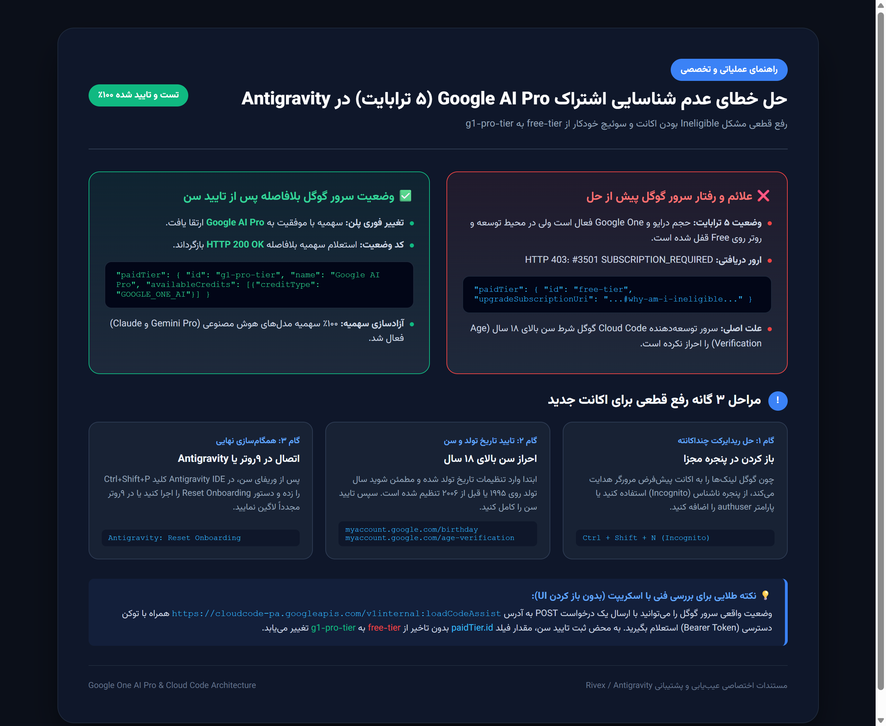

# راهنمای جامع رفع خطای عدم شناسایی اشتراک Google One AI Pro (۵ ترابایت) در Antigravity

[](GOOGLE_ONE_AI_PRO_AGE_VERIFICATION.md)
[](#)



## 📌 شرح مسئله (The Problem)

بسیاری از توسعه‌دهندگان پس از فعال‌سازی اشتراک ۵ ترابایتی گوگل وان (**Google One 5TB AI Pro Plan** - از جمله طرح‌های تخفیفی مانند Jio یا فعال‌سازی مستقیم)، متوجه می‌شوند که در محیط Antigravity IDE یا پروکسی‌های واسط مانند 9router، سهمیه پلن پرو شناسایی نمی‌شود و اکانت روی حالت رایگان قفل مانده است:

```json
HTTP 403 Forbidden: #3501 SUBSCRIPTION_REQUIRED
{
  "error": {
    "code": 403,
    "message": "This account is ineligible for higher rate limits through a Google AI plan at this time.",
    "status": "PERMISSION_DENIED"
  }
}
```

یا در اندپوینت بررسی اشتراک `loadCodeAssist`:

```json
"paidTier": {
  "id": "free-tier",
  "name": "Antigravity Starter Quota",
  "upgradeSubscriptionUri": "https://antigravity.google/docs/faq#why-am-i-ineligible-for-google-one-ai-quotas-even-though-i-am-a-subscribed-to-a-plan"
}
```

---

## 🔍 ریشه‌یابی فنی (Root Cause Analysis)

گوگل سیاست‌های دسترسی به فضای ابری ذخیره‌سازی (**Google Drive / Google One**) را از سرویس‌های هوش مصنوعی توسعه‌دهنده (**Cloud Code / Antigravity**) کاملاً مجزا کرده است:

1. **فضای ابری ۵ ترابایت:** بلافاصله پس از پرداخت بدون نیاز به تایید سن فعال می‌شود.
2. **سهمیه مدل‌های کدنویسی هوش مصنوعی (Gemini Pro و Claude):** طبق قوانین حفاظت از حریم خصوصی کودکان و نوجوانان (مانند COPPA و استانداردهای رگولاتوری AI)، منوط به **احراز سن بالای ۱۸ سال (Age Verification)** است.
3. **تنزل خودکار به Free-Tier:** اگر اکانت فاقد تاریخ تولد ثبت‌شده باشد، تاریخ تولد کمتر از ۱۸ سال باشد، یا از طرف سیستم امنیتی گوگل پرچم‌گذاری سن شده باشد، سرورهای داخلی Cloud Code گوگل (`cloudcode-pa.googleapis.com`) اشتراک ۵ ترابایت را برای بخش هوش مصنوعی «فاقد شرایط» (**Ineligible**) شناسایی کرده و سهمیه توسعه‌دهنده را مسدود می‌کنند.

---

## 🛠️ روش تست و بررسی وضعیت اکانت با اسکریپت (Technical Diagnosis)

برای اینکه بدون حدس و گمان متوجه شوید آیا اکانت شما دچار این مشکل شده است یا خیر، درخواست زیر را به اندپوینت داخلی ارسال کنید:

```bash
curl -X POST https://cloudcode-pa.googleapis.com/v1internal:loadCodeAssist \
  -H "Authorization: Bearer YOUR_ACCESS_TOKEN" \
  -H "Content-Type: application/json" \
  -H "User-Agent: antigravity/ide/2.11.0 darwin/arm64" \
  -d "{}"
```

* **اگر فیلد `paidTier.id` برابر با `free-tier` باشد** و آدرس `upgradeSubscriptionUri` به لینک FAQ درباره ineligible اشاره کند، مشکل ۱۰۰٪ ناشی از عدم احراز هویت سن است.

---

## ⚠️ چالش ریدایرکت چنداکانته گوگل و راه‌حل آن

زمانی که روی لینک‌های تایید سن و تنظیمات گوگل کلیک می‌کنید، مرورگر معمولاً به صورت خودکار صفحه را با اکانت پیش‌فرض (`/u/0/`) باز می‌کند و اجازه ثبت اطلاعات برای اکانت مشکل‌دار را نمی‌دهد.

### راه‌حل‌ها:
1. **روش ناشناس (سریع‌ترین):** در مرورگر کلیدهای `Ctrl + Shift + N` (یا `Cmd + Shift + N` در مک) را بزنید تا پنجره Incognito باز شود. سپس تنها با اکانت مدنظر لاگین کنید.
2. **استفاده از پارامتر مستقیم `authuser`:** آدرس را به شکل زیر باز کنید:
   * `https://myaccount.google.com/birthday?authuser=your_email@gmail.com`
   * `https://myaccount.google.com/age-verification?authuser=your_email@gmail.com`
3. **ساخت پروفایل جداگانه در مرورگر:** در مرورگر Chrome یا Edge یک پروفایل جدید مستقل برای آن جیمیل ایجاد کنید.

---

## 🚀 مراحل گام‌به‌گام رفع قطعی مشکل

### گام ۱: اصلاح تاریخ تولد (Birthday Settings)
1. وارد لینک تنظیمات تاریخ تولد شوید:  
   `https://myaccount.google.com/birthday?authuser=YOUR_EMAIL`
2. سال تولد را روی عددی قبل از ۲۰۰۶ (مثلاً **1995**) تنظیم کرده و ذخیره نمایید.

### گام ۲: تکمیل احراز هویت سن (Age Verification)
1. وارد صفحه رسمی تایید سن گوگل شوید:  
   `https://myaccount.google.com/age-verification?authuser=YOUR_EMAIL`
2. در صورتی که نیاز به کارت بانکی بین‌المللی یا کارت شناسایی باشد، مراحل را طی کنید تا پیام تایید سبز رنگ نمایش داده شود.

### گام ۳: همگام‌سازی نهایی در Antigravity
پس از تایید سن، داده‌های کش سرور محلی را بازنشانی کنید:
* **در Antigravity IDE:** کلیدهای `Ctrl + Shift + P` را فشرده و دستور زیر را اجرا کنید:  
  `Antigravity: Reset Onboarding`  
  سپس مجدداً لاگین کرده و یک سشن جدید آغاز نمایید.
* **در روتر یا ابزارهای پروکسی:** توکن اکانت را یک‌بار Refresh نمایید یا اکانت را Re-authenticate کنید.

---

## ✅ نتیجه نهایی پس از انجام مراحل

بلافاصله پس از تکمیل تایید سن، پاسخ سرور گوگل تغییر کرده و پلن پرو فعال می‌شود:

```json
"paidTier": {
  "id": "g1-pro-tier",
  "name": "Google AI Pro",
  "description": "Google AI Pro",
  "availableCredits": [
    {
      "creditType": "GOOGLE_ONE_AI",
      "minimumCreditAmountForUsage": "50"
    }
  ]
}
```

استعلام سهمیه از اندپوینت `retrieveUserQuotaSummary` نیز پاسخ **`200 OK`** بازگردانده و سهمیه هفتگی و ۵ ساعته مدل‌های Gemini و Claude به میزان ۱۰۰٪ آزاد می‌گردد.
